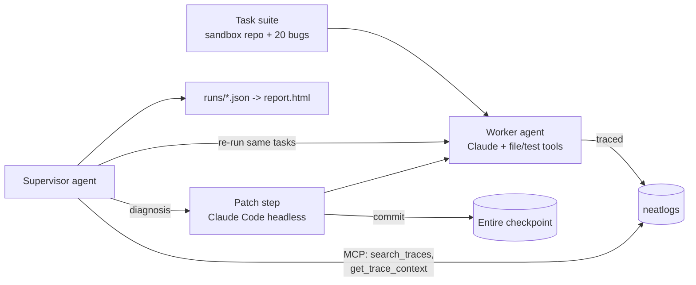

# Mend - plan

Written 9 Oct 2026, before the event, as planning (allowed by the rules). No code exists yet.
Everything below is a plan; numbers appear only after we measure them.

## Pitch
Mend is an agent that reads its own neatlogs traces, rewrites its own code, and proves the fix
with a re-run.

- **One person:** a developer who ships an AI agent and finds out about failures too late.
- **Wow number:** tasks solved on a fixed task set before vs after Mend repaired itself
  ("X of 20 -> Y of 20"). Measured, never estimated.
- **30-second moment:** worker fails live -> supervisor highlights the failing span in neatlogs
  -> patch lands as an Entire checkpoint with its reasoning -> re-run passes, two traces side by side.

## Judging (from neatlogs.com/hackathon) and what we show
| Category | Weight | What we show |
|---|---|---|
| The agent | 30% | Two agents completing a full loop: plan, tools, state, recovery, verification, iteration |
| neatlogs + Entire + cfo.ai | 25% | Traces drive every decision; every self-patch is an Entire checkpoint; cfo.ai business plan |
| Demo video | 20% | Generated video, 3 min or less, fail -> trace -> fix -> proof, all three tools explained |
| Building in public | 15% | #neatHack posts each round: the bug, the trace, the fix, the new score |
| Usefulness / originality | 10% | Every agent team has this problem; self-repair verified by re-run is new |

Evidence the page asks for, and where it comes from: before/after traces (the loop itself),
a failed action and what happened next (any failed task), Entire checkpoints (every patch),
cfo.ai plan (`docs/business-plan`), #neatHack posts, commits dated during the event.

## Architecture

- **Worker:** given a bug report and a copy of the sandbox repo, it reads files, edits code and
  runs the tests. Pass = the repo's tests pass. Each task runs in a fresh temp copy.
- **Supervisor:** after a suite run, it takes each failed task, pulls its trace from neatlogs over
  MCP, finds the failing step, and writes a diagnosis. The patch step changes the *worker's*
  code or prompt. The suite re-runs; keep the patch if the pass count went up, else `git revert`.
- **Why Claude Code for the patch step:** Entire captures coding-agent sessions (Claude Code is
  supported) as checkpoints, so each self-patch automatically carries the reasoning behind it.
  To be verified in the first spike (T03); fallback is a plain commit plus a diagnosis file.

## Stack (default; revise once team skills are known)
| Layer | Choice | Why |
|---|---|---|
| Language | Python 3.11 | neatlogs SDK supports it; AI coding agents write it best; installed |
| Model | Claude via Anthropic API (key already set on the lead's machine) | Works today; Bedrock optional if AWS credits arrive |
| Tracing | neatlogs Python SDK, per docs.neatlogs.com/sdk/python | Required tool |
| Reading traces | neatlogs MCP server (`https://ingest.neatlogs.com/mcp`) | Documented trace search and span tree |
| Change history | Entire CLI 0.11.4 enabled in the repo | Required tool; installed |
| Business plan | cfo.ai | Required tool; account created |
| Tests | pytest | Standard |
| Report / demo | static `report.html` generated from `runs/*.json` | No server, no framework |
| Video | Python + Playwright + edge-tts + ffmpeg (playbook pipeline) | All installed |

## Roles (names filled in once skills are known)
| Role | Owns |
|---|---|
| A - Lead / agents | Worker agent, supervisor loop, neatlogs tracing |
| B - Proof + posts | Sandbox repo and 20 bugs, measurement, Entire checkpoints, README evidence, #neatHack posts |
| C - Report / demo + video | `report.html`, demo mode, screenshots, the whole video pipeline |
| D - Floater | Joins when free and picks any open task; no fixed ownership. cfo.ai plan defaults to B |

## Timeline (IST)
Start time to confirm on Discord: 12:00 AM Sat (email, Luma) vs 12:30 PM (event page FAQ).

| When | Milestone |
|---|---|
| Sat 00:00-03:00 | Repo, CI-free skeleton, spikes: neatlogs trace visible, MCP read works, Entire checkpoint on a Claude Code commit |
| Sat 03:00-09:00 | Sandbox repo with first 5 bugs; worker solves 1 task end to end with a trace. Sleep shift A/B |
| Sat 09:00 | Kickoff call; Entire workshop. Check for rule changes |
| Sat day | Worker on 20 tasks; first baseline score (measured). First build-in-public post |
| Sat night | Supervisor: diagnose from trace -> patch -> re-run -> keep/revert. First real self-fix |
| Sun day | 2-3 self-repair rounds, each logged; report.html; cfo.ai plan; video script final |
| Sun night | Freeze the agent. Record demo, render scenes, assemble video |
| Mon by 15:00 | README with evidence, video final, links checked in incognito |
| Mon 17:00 | Closing call |
| Mon 19:00 | Submit on X (first 50 get engagement) |

## Risks
| Risk | Mitigation |
|---|---|
| Two agents in the time | Worker first; it is a valid submission alone |
| Self-repair shows no gain | Report the real number; seed the worker with known weaknesses (e.g. no retry on test timeout) only if we say so openly |
| MCP read or Entire capture doesn't work as expected | Spikes in the first 3 hours; fallbacks: neatlogs UI screenshots, plain commits + diagnosis files |
| Overlap with neatlogs Investigations | Position as closing the loop: apply and verify, not just suggest |
| Model cost / rate limits | Small task set (20), cheap model for the worker, cache-free short prompts |

## Out of scope
Polished UI, real third-party repos, auto-posting to X, multi-provider support.
